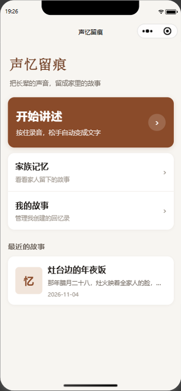
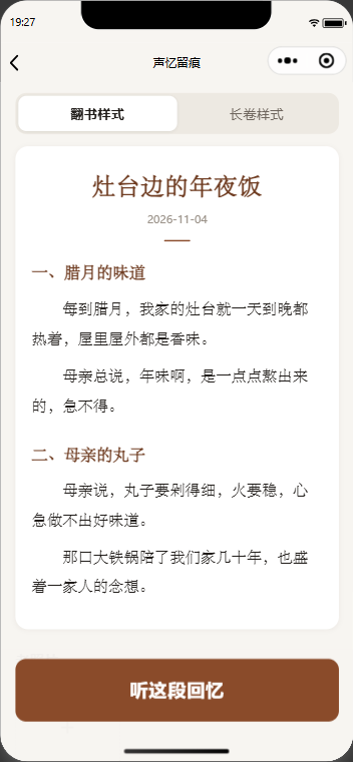
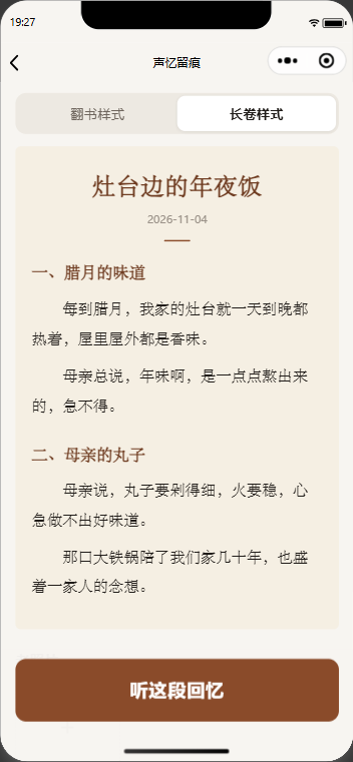
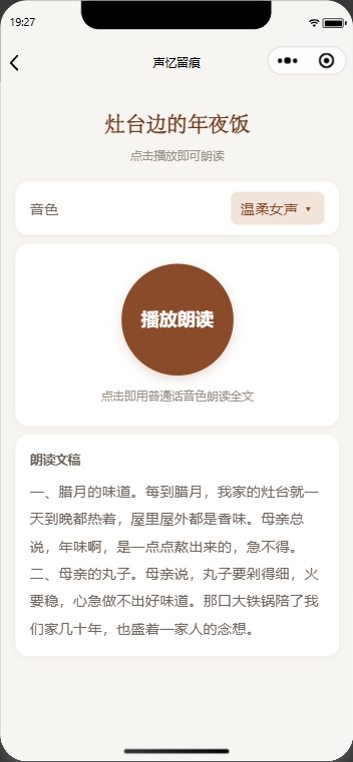

# 声忆留痕

面向老年群体的口述人生 AI 记忆典藏微信小程序。

不做通用陪伴，而是让长辈口述往事、上传老照片，由 AI 自动整理成图文故事与有声回忆录，帮老人留存家族记忆，也给晚辈留下长辈的故事。

## 功能

| 模块 | 说明 |
| --- | --- |
| 口述采集 | 按住大按钮录音，松手后自动转成文字，单次最长 60 秒 |
| AI 故事重构 | 将方言口语整理为分章节、带小标题的第一人称回忆录 |
| 图文排版 | 翻书 / 长卷两套模板，老照片自动穿插 |
| 有声回忆录 | 分段语音朗读，同时支持原始录音回放 |
| 家族记忆 | 故事列表、家人留言、微信分享与本地管理 |

## 技术方案

- **前端**：微信小程序原生开发（WXML / WXSS / JS）
- **数据层**：本地演示模式 / 微信云开发双通道，未配置云环境时自动降级为本地存储
- **语音识别**：百度智能云短语音识别（wav、16k、单声道）
- **故事重构**：OpenAI 兼容大模型接口，固定提示词输出结构化章节
- **语音合成**：前端分段 TTS，按 80 字切段顺序播放
- **云函数**：`asr`、`generateStory`、`tts`、`voiceClone`

## 目录结构

```
.
├─ miniprogram/
│  ├─ app.js / app.json / app.wxss
│  ├─ styles/theme.wxss       适老化主题与统一视觉规范
│  ├─ utils/
│  │  ├─ asr.js               短语音识别与 token 缓存
│  │  ├─ store.js             本地 / 云端数据层与 AI 调用
│  │  └─ util.js              通用工具
│  ├─ components/big-button/  老人友好大按钮
│  └─ pages/                  首页、录音、图文、播放、家族、我的
├─ cloudfunctions/           云函数骨架
├─ scripts/apply-secrets.js  本地密钥注入脚本
└─ docs/screenshots/         界面截图
```

## 快速开始

### 1. 导入项目

用微信开发者工具「导入项目」，目录选择本仓库根目录。AppID 可使用自己的小程序 AppID，或选择测试号体验界面。

### 2. 配置本地密钥

仓库中的密钥均为占位符，不会随代码提交。请先复制模板：

```bash
cp .secrets.local.example.json .secrets.local.json
```

然后填入你自己的密钥：

```json
{
  "llmApiUrl": "你的大模型接口地址（OpenAI 兼容 /chat/completions）",
  "llmApiKey": "你的大模型 API Key",
  "baiduApiKey": "你的百度智能云 API Key",
  "baiduSecretKey": "你的百度智能云 Secret Key"
}
```

然后注入到本地源码：

```bash
node scripts/apply-secrets.js
```

脚本会写入密钥并自动设置 `git update-index --skip-worktree`，避免本地密钥被误提交。若之后需要再次修改 `miniprogram/app.js` 或 `miniprogram/utils/asr.js`，先执行：

```bash
git update-index --no-skip-worktree miniprogram/app.js miniprogram/utils/asr.js
```

### 3. 开发者工具设置

- 右上角「详情 → 本地设置」勾选「不校验合法域名、web-view（业务域名）、TLS 版本以及 HTTPS 证书」
- 允许微信开发者工具使用电脑麦克风
- 编译后，在录音页按住大圆按钮说话，松手即可看到识别文字

### 4. 可选：启用云开发

1. 在云开发控制台创建集合：`stories`、`photos`、`comments`
2. 将集合权限设置为「所有人可读、仅创建者可写」
3. 在 `miniprogram/app.js` 中填入云环境 ID
4. 上传并部署 `cloudfunctions/` 下的云函数，并为 `generateStory` 配置环境变量 `LLM_API_KEY`

配置完成后自动使用云端数据，无需改动页面代码。

## 界面截图

| 首页 | 录音页 |
| --- | --- |
|  |  |

| 图文页（翻书） | 图文页（长卷） |
| --- | --- |
|  |  |

| 有声播放 | 家族记忆 |
| --- | --- |
|  |  |


## 安全说明

- 请勿将任何 API Key、Secret Key、云环境密钥写入源码或提交到仓库。
- 仓库与分发包不包含 AppID、大模型接口地址等可识别配置，均通过本地 `.secrets.local.json` 注入。
- 若密钥曾进入提交历史，应立即到对应平台吊销并重新生成，仅删除文件并不足以消除泄漏。
- `.gitignore` 已排除 `.secrets.local.json`、`.env*`、`node_modules/`、工具缓存与临时截图。

## 当前限制

- 语音识别单次最长 60 秒，长篇讲述需分段录制
- 识别与朗读均为普通话，方言音色尚未接入
- 未配置云环境时数据保存在本机缓存，清理缓存或更换设备后会丢失
- 导出长图、创作人与晚辈的权限控制尚未实现

## 迭代路线

- **V2**：腾讯云方言 ASR / TTS、多段口述合并成篇、导出长图与分享卡片
- **V3**：声音复刻专属音色、家族多人共建、故事时间轴